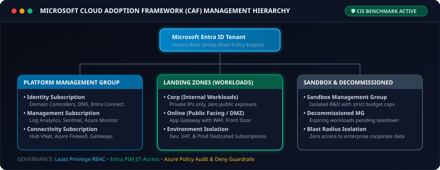
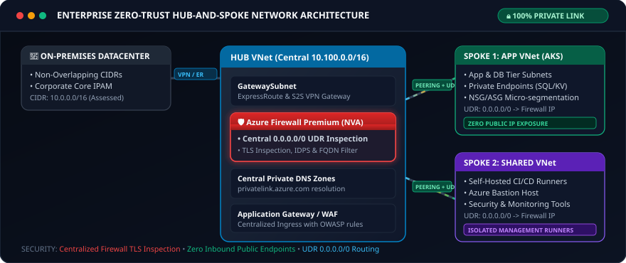
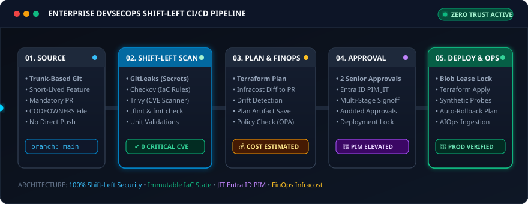
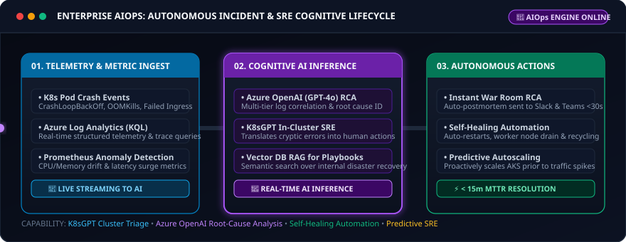
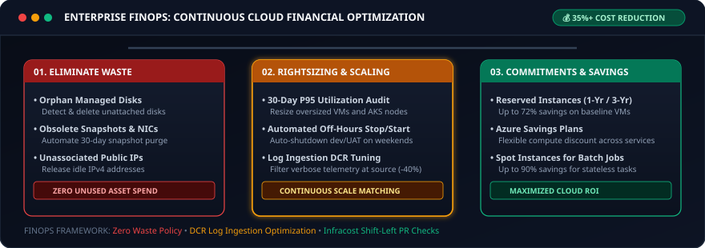
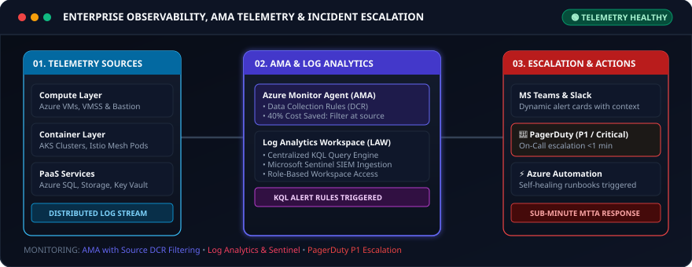

<!-- =========================================================================
     MEHDI SULEMAN | SENIOR DEVSECOPS & ENTERPRISE AUTOMATION ENGINEER
     GitHub Profile Repository: Mehdi-Suleman-DevOps / Mehdi-Suleman-DevOps
     ========================================================================= -->

<div align="center">

  <!-- Dynamic Animated Waving Header Banner -->
  

  <!-- Animated Real-time Glowing Typing SVG -->
  <a href="https://github.com/Mehdi-Suleman-DevOps">
    
  </a>

  <!-- Animated Glowing Cyber Laser Divider -->
  

  <br/>

  <!-- High-Impact Status & Certification Badges -->
  <a href="https://linkedin.com/in/mehdi-suleman">
    
  </a>
  <a href="mailto:mailtomehdi133@gmail.com">
    
  </a>
  <a href="#defense-in-depth-security">
    
  </a>
  <a href="#governance-hierarchy">
    
  </a>
  <a href="#aiops-devops">
    
  </a>

</div>

---

### 💻 Enterprise Terminal Session

<div align="center">
  
</div>

---

### 🌐 Engineering Doctrine

> *"Code without security is an enterprise vulnerability. Infrastructure without automation is unsustainable technical debt. Operations without AI is obsolete."*

I am **Mehdi Suleman**, a **Senior DevSecOps & Enterprise Infrastructure Automation Engineer**. My mission is to build highly resilient, compliant, self-healing cloud platforms. I specialize in designing and operationalizing enterprise infrastructure through **Microsoft Cloud Adoption Framework (CAF)** methodologies, fully automated **Terraform Landing Zones**, **Shift-Left DevSecOps CI/CD pipelines**, and modern **AIOps** intelligent monitoring.

---

### 📊 Operational Benchmarks & SRE KPIs

| Operational Benchmark | Target Standard | Engineering Implementation & Guardrails |
| :--- | :---: | :--- |
| **Infrastructure Availability** | `99.99% Uptime` | Multi-AZ VMSS, Zone-Redundant AKS, Azure Front Door Geo-Failover |
| **Security Gate Enforcement** | `100% Shift-Left` | Zero Critical/High CVEs allowed to production via GitLeaks & Trivy |
| **Deployment Velocity** | `65% Faster Delivery` | Reusable modular Terraform pipelines & automated testing |
| **FinOps Cloud Optimization** | `35%+ Waste Reduced` | Ingestion tuning via DCRs, scheduled downscaling, and Rightsizing |
| **Mean Time to Resolution (MTTR)** | `< 15 Minutes` | AIOps automated incident RCA and K8sGPT cluster diagnostics |

---

## 🛠️ The Enterprise Technology Arsenal

<div align="center">


</div>

<br/>

| Domain | Core Tools & Enterprise Standards |
| :--- | :--- |
| **Cloud Platforms** | Microsoft Azure (Enterprise Landing Zones, CAF), Hybrid Cloud Architecture, AWS |
| **Infrastructure as Code (IaC)** | Terraform, OpenTofu, Terragrunt, Azure Bicep, Ansible, Packer, Cloud-Init |
| **Containers & Orchestration** | Kubernetes (AKS), Docker, Helm, ArgoCD, FluxCD (GitOps), Istio Service Mesh |
| **Shift-Left DevSecOps** | Checkov, tfsec, Trivy, GitLeaks, SonarQube, Snyk, Microsoft Defender for Cloud |
| **CI/CD & Source Control** | Azure DevOps (YAML Pipelines, Branch Policies), GitHub Actions, GitLab CI |
| **AIOps & Modern AI Tooling** | Azure OpenAI (GPT-4o), K8sGPT SRE Diagnostics, Runbook RAG, ML Metric Anomaly Detection |
| **FinOps & Cloud Economics** | Infracost, Azure Cost Management, Azure Policy (Deny/Audit), Reserved Instances |
| **Observability & Telemetry** | Azure Monitor Agent (AMA), Log Analytics Workspace, KQL, Grafana, OpenTelemetry |

<div align="center">
  
</div>

---

<span id="governance-hierarchy"></span>
## 🏛️ 05. Enterprise Governance, Identity & Management Hierarchy

### Cloud Adoption Framework (CAF) Methodology
Microsoft CAF guides end-to-end cloud adoption across six iterative phases:
- **Strategy:** Business justification and measurable ROI.
- **Plan:** Workload alignment, organizational structure, and skill readiness.
- **Ready:** Landing zone preparation, networking foundation, and identity baseline.
- **Adopt:** Migration waves and application modernization sprints.
- **Govern:** Azure Policy, regulatory guardrails, and compliance benchmarks.
- **Secure & Manage:** Continuous threat protection, patching, and operational monitoring.

<br/>

<!-- ANIMATED CAF & MANAGEMENT HIERARCHY SVG -->
<div align="center">
  
</div>

<br/>

#### 🛡️ Best Practices & Architecture Pillars:
- **Subscription Boundaries:** Separate subscriptions by environment (`Dev`, `UAT`, `Prod`) and function (`Platform` vs `Application`) to prevent noisy neighbors and isolate blast radiuses.
- **Azure Policy & Initiatives:** Assign built-in initiatives (e.g., CIS Azure Benchmark, Microsoft Cloud Security Benchmark) at the Management Group level; enforce `Audit` and `Deny` effects with documented, time-bound policy exemptions.
- **RBAC & PIM:** Group-based RBAC with Microsoft Entra ID; enforce Privileged Identity Management (PIM) with just-in-time (JIT) access, mandatory MFA, and multi-stage approvals.

<div align="center">
  
</div>

---

<span id="hub-and-spoke-networking"></span>
## 🌐 06. Enterprise Hub-and-Spoke Networking Architecture

<br/>

<!-- ANIMATED HUB-AND-SPOKE NETWORK TOPOLOGY SVG -->
<div align="center">
  
</div>

<br/>

#### 🔒 Key Networking Elements:
- **IP Address Management (IPAM) & CIDR:** Comprehensive assessment of on-prem CIDRs to ensure zero overlapping address spaces with Azure VNets.
- **Centralized Traffic Inspection:** User Defined Routes (`UDRs`) forcing `0.0.0.0/0` and inter-spoke traffic through the Azure Firewall / Network Virtual Appliance (NVA).
- **Controlled Egress & Ingress:** Centralized Internet egress through firewall with TLS inspection; inbound traffic via Azure Application Gateway / Front Door with Web Application Firewall (WAF).
- **Private Connectivity:** Private Endpoints for all PaaS services (Key Vault, Storage, SQL) with central Private DNS Zone resolution linked to the Hub.

<div align="center">
  
</div>

---

<span id="defense-in-depth-security"></span>
## 🔐 07. Multi-Layered Defense-in-Depth Security

| Layer | Key Controls & Technologies Enforced |
| :--- | :--- |
| **Identity Level** | Microsoft Entra ID, Conditional Access, Multi-Factor Authentication (MFA), Privileged Identity Management (PIM), Service Principals / User-Assigned Managed Identities. |
| **Networking Level** | Hub-and-Spoke, Micro-segmentation via NSGs/ASGs, Azure Firewall Premium (IDPS/TLS inspection), Private Endpoints, DDoS Protection Standard. |
| **Governance Level** | Azure Policy enforcement, CIS / ISO27001 regulatory compliance benchmarks, Microsoft Defender for Cloud Secure Score optimization. |
| **Compute Level** | Defender for Servers, automated vulnerability scanning, Disk Encryption with Customer Managed Keys (CMK), automated OS patch baselines. |
| **Secrets & Data** | Azure Key Vault with RBAC authorization, automated certificate/secret rotation, soft-delete with purge protection, Transparent Data Encryption (TDE). |

<div align="center">
  
</div>

---

<span id="terraform-automation"></span>
## 📦 08. Terraform Landing Zone Automation & Best Practices

### ⚙️ Production IaC Standards:
- **Remote State Management:** Remote state stored in private Azure Storage Account with blob lease locking, encrypted at rest, and accessed via Least Privilege Managed Identities.
- **Modularity:** Reusable, parameterized Terraform modules with strict semantic versioning (`v1.x.x`).
- **Automated Drift Detection:** Scheduled nightly pipelines running `terraform plan -detailed-exitcode` to catch manual console changes immediately.

<details>
<summary><b>🔍 View Modular Terraform Enterprise Directory Structure</b></summary>

```
terraform-enterprise-landing-zone/
├── .github/workflows/         # Automated CI/CD validation & drift detection
├── modules/
│   ├── networking/            # Hub-and-Spoke, Subnets, UDRs, Peerings
│   ├── security/              # Azure Firewall, NSGs, ASGs, Key Vault
│   ├── governance/            # Azure Policy definitions & initiative assignments
│   └── compute/               # AKS Cluster, VMSS, Managed Identities
├── environments/
│   ├── dev/                   # Environment overrides & tfvars
│   ├── uat/                   # Staging configurations
│   └── prod/                  # Production lockdown settings
├── backend.tf                 # Azure Blob remote state with lease locking
├── main.tf                    # Core orchestration root
├── variables.tf               # Type-safe input validations
└── outputs.tf                 # Exported endpoints & resource IDs
```
</details>

<div align="center">
  
</div>

---

<span id="devsecops-pipelines"></span>
## 🚀 09. Azure Repos & DevSecOps Pipelines

### 🌿 Branching Strategy & Governance
- **Trunk-Based Development** with short-lived feature branches (`feature/*`, `fix/*`).
- **Strict Branch Policies on `main`:**
  - Strict branch protection on `main`.
  - Mandatory Pull Request (PR) with minimum 2 senior reviewers.
  - Code owners (`CODEOWNERS`) file enforcement.
  - "No Delete" and "No Direct Push" on production branches.

<br/>

<!-- ANIMATED DEVSECOPS SHIFT-LEFT PIPELINE SVG -->
<div align="center">
  
</div>

<br/>

- **Validate & Test:** `terraform validate`, `tflint`, and unit tests.
- **Security & Secrets:** GitLeaks, Checkov, and Trivy vulnerability scans.
- **Build & Plan:** Generate and publish execution plan artifact.
- **Approval Gate:** Manual approval for UAT/Production deployments.
- **Deploy & Apply:** Execute deployment safely with automated status polling.
- **Automated Rollback:** Automated failure rollback plan on unhealthy probe signals.
- **Custom Middleware Setup:** VM custom data / Cloud-Init scripts for baseline configuration and agent bootstrapping.

<details>
<summary><b>📄 View Production DevSecOps Azure Pipelines YAML Template</b></summary>

```yaml
# Azure DevOps DevSecOps Multi-Stage Pipeline
trigger:
  branches:
    include:
      - main

pool:
  vmImage: 'ubuntu-latest'

stages:
- stage: SecurityValidation
  displayName: "Shift-Left Security & Linting"
  jobs:
  - job: Scan
    steps:
    - task: Bash@3
      displayName: "Secret Detection (GitLeaks)"
      inputs:
        targetType: 'inline'
        script: gitleaks detect --source . --verbose
    - task: Bash@3
      displayName: "IaC Static Analysis (Checkov)"
      inputs:
        targetType: 'inline'
        script: checkov -d . --framework terraform --compact --quiet
    - task: Bash@3
      displayName: "Cost Estimation (Infracost)"
      inputs:
        targetType: 'inline'
        script: infracost breakdown --path .

- stage: DeployProduction
  displayName: "Gated Production Deployment"
  dependsOn: SecurityValidation
  jobs:
  - deployment: ApplyInfrastructure
    environment: 'production-cloud'
    strategy:
      runOnce:
        deploy:
          steps:
          - script: terraform apply -input=false -auto-approve tfplan
            displayName: "Execute Production Apply"
```
</details>

<div align="center">
  
</div>

---

<span id="aiops-devops"></span>
## 🤖 10. Artificial Intelligence in DevOps (AIOps)

> *Integrating Machine Learning and LLMs into the DevOps lifecycle to turn reactive firefighting into predictive, automated, and self-healing operations.*

<br/>

<!-- ANIMATED AIOPS ARCHITECTURE SVG -->
<div align="center">
  
</div>

<br/>

### 🧠 Core AIOps Implementation Capabilities:
1. **Automated Incident Root Cause Analysis (RCA):**
   - Ingests KQL log queries across distributed microservices during alerts.
   - LLM correlates error spikes across dependent services, identifies the culprit git commit/deployment, and drafts a comprehensive post-mortem in under 30 seconds.
2. **K8sGPT Cluster SRE Diagnostics:**
   - In-cluster AI operator directly intercepts `CrashLoopBackOff`, `OOMKilled`, and failed Service Endpoints, translating cryptic Kubernetes events into actionable natural language remediations.
3. **Retrieval-Augmented Generation (RAG) for Incident Runbooks:**
   - Vector database indexing internal architecture diagrams, disaster recovery playbooks, and historical incident resolutions.
   - On-call engineers receive context-specific, tested mitigation procedures directly in incident channels.
4. **Predictive Autoscaling & Anomaly Detection:**
   - Machine learning algorithms analyze historical time-series traffic patterns to scale Kubernetes node pools *prior* to forecasted demand spikes, avoiding latency degradation.
5. **AI-Assisted IaC Review:**
   - Automated PR bot analyzing Terraform pull requests against the Azure Well-Architected Framework and CIS benchmarks, providing actionable optimization advice to developers before peer review.

<div align="center">
  
</div>

---

<span id="finops-management"></span>
## 💰 11. FinOps (Cloud Financial Management)

<br/>

<!-- ANIMATED FINOPS CONTINUOUS OPTIMIZATION SVG -->
<div align="center">
  
</div>

<br/>

- **Eliminate Waste:** Detect and remove unattached managed disks, obsolete snapshots, unassociated public IPs, and idle compute instances.
- **Rightsizing:** Resize oversized VMs and container workloads based on 30-day CPU/Memory utilization percentiles.
- **Commitment Discounts:** Reserved Instances (1-year or 3-year RI) and Azure Savings Plans for steady-state workloads.
- **Automated Scheduling:** Automated start/stop for non-production environments outside business hours to eliminate weekend idle spend.
- **Log Ingestion Tuning:** Review Azure Monitor log ingestion tables; configure Data Collection Rules (DCR) to filter noisy diagnostic logs at the source, drastically reducing monthly Log Analytics expenses.

<div align="center">
  
</div>

---

<span id="bcdr-high-availability"></span>
## 🔄 12. Backup, Disaster Recovery & High Availability

### Storage Redundancy Matrix
| Storage Model | Copies | Scope | Target Workload |
| :--- | :---: | :--- | :--- |
| **LRS (Locally Redundant Storage)** | 3 | Single datacenter | Non-critical dev/test data |
| **ZRS (Zone-Redundant Storage)** | 3 | Across 3 Availability Zones in region | Production mission-critical data |
| **GRS (Geo-Redundant Storage)** | 6 | Replicated to secondary paired region | Enterprise disaster recovery compliance |

### 🎯 High Availability Architecture & SLAs
- **High Availability Compute:** Virtual Machine Scale Sets (VMSS) and multi-node AKS clusters distributed across multiple Availability Zones.
- **RTO & RPO Definitions:**
  - **RTO (Recovery Time Objective):** Maximum acceptable duration of downtime before system is restored (Target: `< 30 minutes`).
  - **RPO (Recovery Point Objective):** Maximum acceptable data loss measured in time (Target: `< 15 minutes` of transactional data).
- **Region Strategy:** Primary active region with Azure Site Recovery (ASR) replicating critical compute to secondary paired region with automated failover playbooks.

<div align="center">
  
</div>

---

<span id="observability-monitoring"></span>
## 📊 13. Enterprise Observability & Monitoring

<br/>

<!-- ANIMATED OBSERVABILITY & TELEMETRY SVG -->
<div align="center">
  
</div>

<br/>

- **Azure Monitor & Log Analytics:** Centralized Log Analytics Workspace per enterprise landing zone with role-based workspace access controls.
- **Azure Monitor Agent (AMA):** Telemetry ingestion filtered at the source via Data Collection Rules (DCR) to optimize cost, network bandwidth, and performance.
- **Alerting & Escalation:** Action Groups routing alerts dynamically to Microsoft Teams channels, Slack, or PagerDuty for critical incidents with automated escalation trees.

<div align="center">
  
</div>

---

## 📈 GitHub Pulse & Metrics

<div align="center">

  <table border="0">
    <tr>
      <td>
        
      </td>
      <td>
        
      </td>
    </tr>
  </table>

</div>

---

## 🤝 Connect & Collaborate

<div align="center">

  <p>
    Interested in enterprise DevSecOps pipelines, zero-trust infrastructure, or integrating AI into cloud operations? Let's connect!
  </p>

  <a href="https://linkedin.com/in/mehdi-suleman">
    
  </a>
  &nbsp;
  <a href="mailto:mailtomehdi133@gmail.com">
    
  </a>
  &nbsp;
  <a href="https://github.com/Mehdi-Suleman-DevOps">
    
  </a>

  <br/><br/>

  <!-- Dynamic Waving Footer -->
  

</div>
